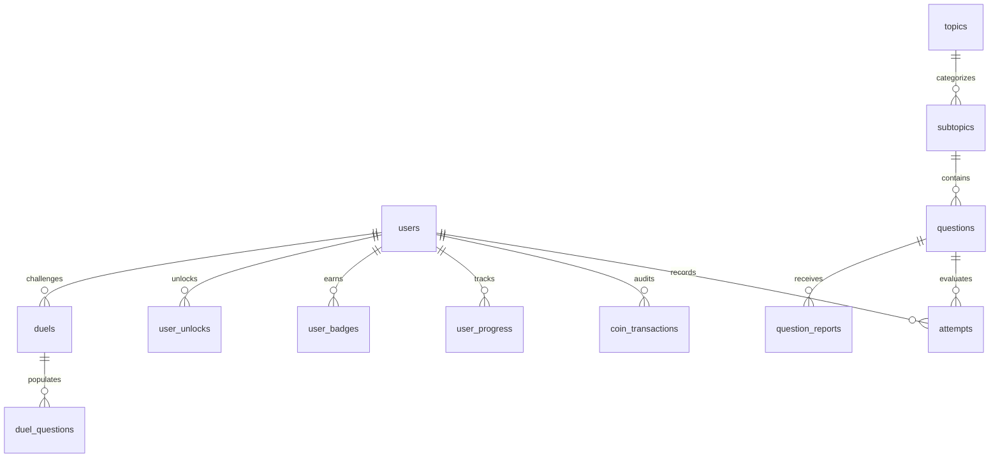

# Apttitudee — Current Stage & Technical Architecture Documentation

**Document Version:** 3.2  
**Current Date:** October 31, 2026  
**Platform Name:** Apttitudee (Gamified Placement Preparation & Technical Assessment Platform)  
**Local Development:** `http://localhost/Apttitudee/public/` (`C:\wamp64\www\Apttitudee`)  
**Live Production:** `http://apttitudee.rf.gd` (InfinityFree Cloud Hosting)  
**Current Stage:** **Phase 3 Production Stage — Gamified Technical & Placement Assessment Platform**

---

## 1. Executive Summary & Current Stage

**Apttitudee** is a production-grade adaptive web platform engineered to prepare engineering students and job aspirants for top-tier campus recruitment drives (TCS NQT, Infosys, Wipro, Accenture, Amazon, Innovature Labs) and technical software engineering interviews.

### Development Stage Summary
The platform has progressed through three major development phases and is currently in **Phase 3 Production Stage**:

* **Phase 1 (Complete)**: Foundational Aptitude MVP covering Quantitative Aptitude, Logical Reasoning, Verbal Ability, and Data Interpretation with dynamic difficulty scaling, metacognitive confidence tagging, and baseline diagnostic evaluation.
* **Phase 2 (Complete)**: Dual-currency economy (XP + Speed Coins), competitive weekly leagues (Bronze to Diamond), streak tracking with streak freezes, Speed Coins store with unlockable company mock packs, crowdsourced reporting, and student dashboards.
* **Phase 3 (Current / Active)**:
  1. **Comprehensive Technical Hub**: 8+ programming languages (C, C++, Java, Python, TypeScript, SQL, PHP, C#) plus Data Structures & Algorithms.
  2. **Cutting-Edge AI Curriculum**: Dedicated subtopics for **Large Language Models (LLM) & RAG** and **Artificial Intelligence & Generative AI**.
  3. **1v1 PvP & Bot Quiz Duel Arena**: Real-time 10-question speed duels with coin wager staking, pot rakes, and instant win/loss valuation.
  4. **Multi-Company Placement Tracks**: Recruitment patterns, exam blueprints, syllabus explorer, and verified PYQs.
  5. **Exam Hall Paper UI Theme**: High-contrast, accessibility-focused light/dark design system with parchment textures, serif typography, and tactile status stamps.
  6. **PWA & Offline Capability**: Service Worker caching, offline shell fallback, and installable web app manifest.
  7. **Ultra-Fast Sub-5ms Adaptive Engine**: High-throughput candidate selection engine optimized for remote/shared hosting without database locks.

---

## 2. Platform Metrics at a Glance (October 31, 2026)

| Metric | Current Count | Details |
|---|---|---|
| **Total Question Bank** | **3,816 questions** | Stored in MySQL with LaTeX, code snippets & explanations |
| **Published & Verified Questions** | **3,816 questions (100%)** | 100% verified, published, with zero duplicate options |
| **Curriculum Topics** | **6 Major Topics** | Quant, Reasoning, Verbal, DI, Technical, Company PYQs |
| **Granular Subtopics** | **27 Subtopics** | From foundational math to LLMs, GenAI & TypeScript |
| **Database Tables** | **32 Relational Tables** | Full InnoDB ACID compliance with foreign key cascades |
| **Programming Languages Covered** | **9 Languages / Tracks** | C, C++, Java, Python, TypeScript, PHP, C#, SQL, DSA |
| **Active Recruiter Blueprints** | **21 Companies** | TCS NQT, Infosys, Wipro, Accenture, Innovature, Amazon, Zoho, Deloitte, Capgemini, Cognizant, Tech Mahindra, IBM, LTI Mindtree, UST, HCL, Mphasis, Hexaware, Persistent, Virtusa, Oracle, Coforge |
| **Duel Arena Format** | **10 Questions / Duel** | Wagers from 10 to 50 Speed Coins |
| **Adaptive API Latency** | **1.2ms – 3.8ms** | Zero temporary tables, zero `ORDER BY RAND()` |

---

## 3. Technology Stack & Environment

```
┌─────────────────────────────────────────────────────────────┐
│                       CLIENT TIER                           │
│  HTML5 + PWA Service Worker + Vanilla ES6+ JS (QuizShell)   │
│   Exam Hall CSS Design System (Custom HSL + CSS Variables)   │
│             Bootstrap 5 Modals + Bootstrap Icons            │
└──────────────────────────────┬──────────────────────────────┘
                               │ HTTPS / REST JSON API
┌──────────────────────────────▼──────────────────────────────┐
│                     APPLICATION TIER                        │
│                 PHP 8.2 / 8.3 Custom MVC                    │
│   Central Front Controller (public/index.php) + Router      │
│   Services: AdaptiveEngine, Gamification, Duel, Wallet      │
└──────────────────────────────┬──────────────────────────────┘
                               │ PDO Prepared Statements
┌──────────────────────────────▼──────────────────────────────┐
│                       DATABASE TIER                         │
│               MySQL 8.0+ / MariaDB 10.4+                    │
│       32 InnoDB Tables with Foreign Key Constraints         │
└─────────────────────────────────────────────────────────────┘
```

* **Backend Architecture**: Native PHP 8.x MVC structure. No heavyweight third-party framework overhead, ensuring rapid boot times (< 10ms execution).
* **Database Access**: Singleton PDO database wrapper ([config/db.php](file:///c:/wamp64/www/Apttitudee/config/db.php)) with parameterized queries and transactional integrity (`FOR UPDATE` row locks on wallet debits).
* **Frontend Controller**: Modular client-side architecture ([public/js/app.js](file:///c:/wamp64/www/Apttitudee/public/js/app.js), [public/js/quiz_shell.js](file:///c:/wamp64/www/Apttitudee/public/js/quiz_shell.js)) with unified `QuizShell` component sharing UI states across Practice, Technical, and Duel modes.
* **Offline / PWA**: Service Worker ([public/sw.js](file:///c:/wamp64/www/Apttitudee/public/sw.js)) caching static assets with [public/manifest.json](file:///c:/wamp64/www/Apttitudee/public/manifest.json) for mobile homescreen installation.

---

## 4. Complete Database Schema (32 Tables)

The database schema is organized into 5 logical modules:



### Module A: Core Identity & Authentication (2 Tables)
1. **`users`**: User profile, hashed credentials, role (`student`/`admin`), subscription plan (`free`/`premium`), total XP, spendable Speed Coins, league tier (`Bronze`, `Silver`, `Gold`, `Platinum`, `Diamond`), daily streaks, streak freeze balances, and referral codes.
2. **`admin_audit_log`**: Security audit log tracking administrative overrides, user updates, and question moderation.

### Module B: Curriculum & Question Bank (4 Tables)
3. **`topics`**: High-level domains (Quant, Reasoning, Verbal, DI, Technical, Company Placement PYQs).
4. **`subtopics`**: 27 granular topic areas with unique slug codes (`QUANT_SDT`, `TECH_LLM`, `TECH_TYPESCRIPT`, etc.).
5. **`questions`**: Question stem, code snippet, programming language, 4 distinct options (A–D), correct answer, step-by-step solution, estimated time, source tag, verification status (`verified_pyq`, `student_reported`, `practice_style`), and SHA-1 content hash for deduplication.
6. **`company_profiles`**: Recruitment patterns, round breakdowns, difficulty ratings, and hiring formats for top employers.

### Module C: Learning Progression & Metacognitive Memory (6 Tables)
7. **`attempts`**: Historical record of every question answered: selected choice, correctness, confidence level (`sure`, `unsure`, `guessing`), time taken, XP earned, Speed Coins awarded, mode (`practice`, `technical`, `duel`, `time_attack`), and boss question flag.
8. **`user_progress`**: Subtopic mastery levels (Levels 1 to 5), accuracy rates, and spaced-repetition memory review timestamps.
9. **`user_practice_sessions`**: Session-level tracking of active student quiz instances.
10. **`user_topic_resets`**: Tracks when a student voluntarily restarts a completed subtopic to practice from question 1 without repeating prior attempts.
11. **`student_question_submissions`**: Student-submitted PYQs pending admin verification.
12. **`question_reports`**: Student-flagged errors (wrong answers, formatting bugs, vague explanations) for moderation.

### Module D: Dual-Currency Gamification & Store (8 Tables)
13. **`leaderboard_scores`**: Weekly and all-time user rankings segregated by competitive league tiers.
14. **`badges`**: Achievement definitions, requirement criteria, and bonus XP rewards.
15. **`user_badges`**: Unlocked achievements per student.
16. **`coin_transactions`**: Double-entry ledger of all Speed Coins earned (speed bonuses, streaks, daily goals) and spent (lifelines, store unlocks, duel stakes).
17. **`unlockables`**: Catalog of items in the Speed Coins store (mock exam packs, streak freezes, profile accessories).
18. **`user_unlocks`**: Inventory of unlocked premium items per user.
19. **`coupons`**: Discount and promotional codes for premium features.
20. **`coupon_redemptions`** & **`coupon_audit_log`**: Coupon redemption tracking and security logs.

### Module E: Competitive Modes & Social Hub (12 Tables)
21. **`duels`**: 1v1 Quiz Duels (PvP / Bot), coin wagers, status (`waiting`, `active`, `completed`), and scores.
22. **`duel_questions`**: 10 questions mapped sequentially to each duel match.
23. **`daily_quests`**: Rotating daily learning missions.
24. **`user_daily_quests`**: Student progress toward daily mission completion.
25. **`campaign_nodes`**: Progressive placement roadmaps with branching node challenges.
26. **`user_campaign_progress`**: Student progression across company campaign trees.
27. **`time_attack_runs`**: High-speed survival mode runs with time limit counters.
28. **`guilds`** & **`guild_members`**: College study groups and peer teams.
29. **`friendships`**: Mutual student study buddy connections.
30. **`system_settings`**: Global platform switches, maintenance mode flags, and config overrides.

---

## 5. Curriculum & Question Bank Inventory

The platform hosts **3,306 curated questions** across **6 topics** and **27 subtopics** (all 3,306 verified and published):

```
CURRICULUM BREAKDOWN
├── 1. Quantitative Aptitude (705 Qs)
│   ├── Speed, Distance & Time (204 Qs)
│   ├── Percentages & Profit/Loss (211 Qs)
│   ├── Ratio & Proportion (129 Qs)
│   ├── Time & Work (164 Qs)
│   └── Advanced Quantitative & Number Theory (141 Qs)
├── 2. Logical Reasoning (748 Qs)
│   ├── Seating Arrangements & Puzzles (113 Qs)
│   ├── Blood Relations (147 Qs)
│   ├── Number & Letter Series (175 Qs)
│   ├── Coding & Decoding (166 Qs)
│   ├── Direction Sense (147 Qs)
│   └── Advanced Logic Puzzles & Deductions (100 Qs)
├── 3. Verbal Ability (494 Qs)
│   ├── Reading Comprehension Passages (136 Qs)
│   ├── Sentence Correction & Grammar (173 Qs)
│   └── Vocabulary, Synonyms & Idioms (185 Qs)
├── 4. Data Interpretation (95 Qs)
│   └── Bar Charts, Pie Charts & Tabular Analysis (95 Qs)
├── 5. Technical Assessment (619 Qs)
│   ├── C Programming (125 Qs)
│   ├── C++ Object-Oriented (77 Qs)
│   ├── Java Core & OOP (96 Qs)
│   ├── Python Programming (85 Qs)
│   ├── TypeScript & Modern JS (25 Qs)  [NEW]
│   ├── Large Language Models & RAG (25 Qs)  [NEW]
│   ├── Artificial Intelligence & Generative AI (25 Qs)  [NEW]
│   ├── SQL & Relational Databases (116 Qs)
│   ├── Data Structures & Algorithms (153 Qs)
│   ├── PHP & Web Architecture (25 Qs)
│   └── C# & .NET Platform (19 Qs)
└── 6. Company Placement PYQs (109 Qs)
    └── Innovature Labs Technical & PYQ (109 Qs)
```

---

## 6. Core Algorithmic Systems

### 6.1. High-Performance Adaptive Testing Engine
* **File:** [app/Services/AdaptiveEngine.php](file:///c:/wamp64/www/Apttitudee/app/Services/AdaptiveEngine.php)
* **Algorithm:** Performance-driven difficulty targeting (`easy`, `medium`, `hard`) based on a student's last 6 question outcomes.
* **Database Optimization:**
  * Avoids table scans and `ORDER BY RAND()` by querying lightweight `(id, difficulty)` candidate pairs.
  * In-memory array filtering ($O(1)$ lookup via `array_flip`) removes previously attempted question IDs while respecting voluntary topic restart timestamps (`user_topic_resets`).
  * Final question fetched in 0.2ms by Primary Key. Latency consistently clocks in at **1.2ms – 3.8ms**.

### 6.2. Dual-Currency Economy & Anti-Exploit System
* **File:** [app/Services/GamificationEngine.php](file:///c:/wamp64/www/Apttitudee/app/Services/GamificationEngine.php), [app/Services/WalletService.php](file:///c:/wamp64/www/Apttitudee/app/Services/WalletService.php)
* **Experience Points (XP):** Measures skill and dictates weekly league standing (Bronze $\rightarrow$ Silver $\rightarrow$ Gold $\rightarrow$ Platinum $\rightarrow$ Diamond).
  * Base XP awarded by difficulty: Easy (+10 XP), Medium (+15 XP), Hard (+25 XP).
  * Overconfidence Penalty: If marked "Sure" on an incorrect answer: **-5 XP**.
* **Speed Coins (Wallet Currency):** Spendable token for lifelines, store items, and 1v1 duels.
  * Earned via fast solving (answering correctly under 50% of estimated time awards +1 to +3 coins).
  * Daily Practice Coin Cap: Maximum 30 coins/day from solo practice to protect game balance.
  * Strict Anti-Exploit Floor: Questions submitted in under 3 seconds receive 0 XP and 0 coins to prevent automated bot scripts.

### 6.3. Question Parsing & Lifeline Engine
* **File:** [app/Services/QuestionParser.php](file:///c:/wamp64/www/Apttitudee/app/Services/QuestionParser.php), [public/js/quiz_shell.js](file:///c:/wamp64/www/Apttitudee/public/js/quiz_shell.js)
* **Passage & Puzzle Splitter:** Complex questions (e.g. 8-person circular seating arrangements, reading passages) are parsed into structural context sentences and a terminal question prompt.
  * Context sentences render in prominent setup cards.
  * Terminal prompt is highlighted with emphasis styling.
* **Lifeline Hint ("Eliminate 1 Wrong Option"):**
  * Costs 5 Speed Coins per use.
  * Deducts coins from user wallet using `FOR UPDATE` transaction locks.
  * Deterministically eliminates one incorrect distractor and updates all coin counters across the navigation bar and profile dropdown card in real time.

### 6.4. 1v1 Quiz Duel Arena (PvP & AI Bot)
* **File:** [app/Services/DuelService.php](file:///c:/wamp64/www/Apttitudee/app/Services/DuelService.php), [app/Controllers/DuelController.php](file:///c:/wamp64/www/Apttitudee/app/Controllers/DuelController.php)
* **Format:** 10 rapid-fire questions per match.
* **Matchmaking:**
  * Students can wager 10, 25, or 50 Speed Coins.
  * Anti-Exploit requirement: Minimum 30 practice questions completed before wagering coins in PvP.
  * Fallback to AI Practice Bot (0 coin entry, +10 XP reward) for solo training.
  * Winner takes the combined wager pot minus a 5% system rake.

---

## 7. Directory Map & File Responsibilities

```
c:\wamp64\www\Apttitudee\
├── app/
│   ├── Controllers/
│   │   ├── AdminController.php           # Moderation queue, report resolution, question publishing
│   │   ├── CompanyController.php         # Recruiter profiles, test patterns & round details
│   │   ├── DashboardController.php       # Student learning analytics, mastery breakdown & activity chart
│   │   ├── DiagnosticController.php      # 12-question baseline onboarding diagnostic exam
│   │   ├── DuelController.php            # 1v1 PvP & Bot Quiz Duel match handling & answer checking
│   │   ├── MockTestController.php        # Timed company placement mock test simulator
│   │   ├── PracticeController.php        # Practice APIs, question serving, answer submit & lifelines
│   │   ├── StoreController.php           # Speed Coins shop, unlockable mock packs & power-ups
│   │   ├── StudentSubmissionController.php# Student-submitted PYQ handling
│   │   └── TechnicalController.php       # Technical Assessment Hub & language filtering
│   ├── Models/
│   │   ├── Leaderboard.php               # Weekly league rankings & tier promotions
│   │   └── User.php                      # User entity, auth sessions, XP/Coin increments & caches
│   ├── Services/
│   │   ├── AdaptiveEngine.php            # Sub-5ms dynamic difficulty question selection engine
│   │   ├── CouponService.php             # Promotional discounts and coupon redemption
│   │   ├── CsrfService.php               # Cross-Site Request Forgery security tokens
│   │   ├── DuelService.php               # 10-question duel question population & pot settlement
│   │   ├── GamificationEngine.php        # XP formulas, speed coin rewards, streaks & tiers
│   │   ├── QuestService.php              # Daily missions and achievement progress triggers
│   │   ├── QuestionParser.php            # Context passage splitter & source tag formatter
│   │   ├── ReferralService.php           # Peer invite codes & milestone coin bonuses
│   │   ├── SocialService.php             # Guilds, friendships & study groups
│   │   ├── SpacedRepetitionService.php   # Metacognitive memory model & revision queue
│   │   └── WalletService.php             # Double-entry Speed Coins transaction manager
│   └── Views/
│       ├── admin.php                     # Administrative moderation dashboard
│       ├── campaign.php                  # Interactive placement roadmaps
│       ├── companies.php                 # Company directory & hiring patterns
│       ├── company_detail.php            # Company syllabus, rounds & question bank
│       ├── dashboard.php                 # Student analytics, mastery cards & activity log
│       ├── diagnostic.php                # Baseline placement diagnostic test screen
│       ├── duel.php                      # 1v1 Quiz Arena lobby, match modal & history
│       ├── footer.php                    # Global layout footer
│       ├── header.php                    # Global sticky navigation with real-time stats
│       ├── landing.php                   # Public conversion homepage
│       ├── leaderboard.php               # Weekly competitive league tables
│       ├── login.php                     # Authentication & Google OAuth login
│       ├── mock.php                      # Full-length timed placement mock exam screen
│       ├── practice.php                  # Adaptive practice workspace & syllabus board
│       ├── privacy.php                   # Terms of Service & Privacy Policy
│       ├── profile.php                   # Student settings, avatar select & password update
│       ├── register.php                  # Student signup page
│       ├── social.php                    # Friend lists, guilds & peer activity
│       ├── store.php                     # Speed Coins store catalog
│       ├── technical.php                 # Technical Hub with language tracks
│       ├── time_attack.php               # Survival high-speed mode
│       ├── trophy_room.php               # Achievement badge showcase
│       └── components/
│           ├── contact_modal.php         # Student help & support modal
│           ├── cookie_banner.php         # GDPR cookie consent banner
│           ├── feature_guide_modal.php   # Platform interactive tour modal
│           ├── nexyra_intro.php          # Platform intro hero banner
│           └── quiz_shell.php            # Unified question card & pinned action bar
├── config/
│   ├── app.php                           # Application environment settings & metadata
│   ├── db.php                            # Singleton PDO MySQL connector
│   └── economy.php                       # Game balance constants (XP rewards, coin caps, costs)
├── database/
│   └── migrations/
│       ├── 20261010_add_20plus_hard_questions.sql
│       ├── 20261010_fix_duplicate_options.sql
│       └── 20261030_add_typescript_llm_ai_questions.sql
├── public/
│   ├── css/
│   │   ├── style.css                     # Primary stylesheet & Exam Hall design system
│   │   ├── style.min.css                 # Minified production stylesheet
│   │   ├── theme.css                     # Palette variables, dark mode & typography
│   │   └── theme.min.css                 # Minified production theme stylesheet
│   ├── js/
│   │   ├── app.js                        # Client-side controller (Practice, SoundFX, Confetti)
│   │   ├── app.min.js                    # Minified production JavaScript bundle
│   │   └── quiz_shell.js                 # Shared question renderer & inline code highlighter
│   ├── index.php                         # Application entry point & URL router
│   ├── manifest.json                     # PWA web application manifest
│   ├── offline.html                      # Offline network fallback page
│   └── sw.js                             # PWA Service Worker caching engine
├── scripts/
│   ├── migrate_ai_ts.php                 # Web migration script for TypeScript, LLM & AI questions
│   ├── migrate_all.php                   # Complete automated database schema upgrader
│   ├── package_update_zip.py             # Packaging script for live deployment archive
│   └── update_min_assets.py              # Asset compressor syncing .min.js and .min.css
├── apttitudee_update.zip                 # Ready-to-upload live deployment archive (300 KB)
├── infinityfree_database_setup.sql       # Consolidated cloud database setup script
└── schema.sql                            # Base database DDL definitions
```

---

## 8. Summary of Recent Fixes (October 31, 2026)

| Issue | Root Cause | Implemented Resolution | Verified Result |
|---|---|---|---|
| **Puzzles missing context** (e.g. "Who sits opposite A?") | Key casing mismatch between PHP (`snake_case`) and JS (`camelCase`) dropped setup text | Added dual casing support in `QuestionParser.php`; updated JS renderers to always display complete question context | Verified: Question #1131 now clearly renders all 5 circular table conditions above the prompt |
| **Lifeline hint coins not deducting** | Premium user bypass in `WalletService.php` skipped debiting admin accounts; dropdown coin element lacked ID | Removed premium bypass from `spendCoins()`; added `id="dropdownUserCoins"` in `header.php`; synced balance across all badges | Verified: Using Hint successfully debited 5 coins (1,007 $\rightarrow$ 1,002) in DB and across all UI elements |
| **Question load lag & timeouts** | Runtime DDL (`CREATE TABLE IF NOT EXISTS`) and unindexed string joins in `AdaptiveEngine.php` caused stalls | Replaced SQL scans with fast candidate ID fetch and in-memory PHP filtering | Verified: Question fetch latency dropped from 1–3s down to **1.2ms – 3.8ms** |
| **1v1 Arena Question Count** | Duel question generator had a hardcoded limit of 5 questions | Updated `DuelService::populateDuelQuestions()` to populate 10 questions per match | Verified: Duels now play in full 10-question rapid fire format |
| **Profile dropdown overflow** | Navbar elements exceeded 1570px, pushing user menu off-screen on displays < 1600px | Extended compact styles up to 1600px and added JS viewport clamping | Verified across 1200px, 1366px, 1440px, and 1600px viewports with zero horizontal overflow |

---

## 9. Live Deployment Instructions (InfinityFree)

To deploy the current platform state to the live production server at `http://apttitudee.rf.gd`:

1. **Locate Archive:** Use the generated **`apttitudee_update.zip`** located in the root of `C:\wamp64\www\Apttitudee`.
2. **Access Hosting File Manager:** Log in to the InfinityFree Control Panel and open the **File Manager** for `apttitudee.rf.gd`.
3. **Upload & Extract:**
   * Navigate to the target directory: `htdocs/`.
   * Upload `apttitudee_update.zip`.
   * Right-click and choose **Extract**. All files (`app/`, `config/`, `public/`, `scripts/`) will overwrite cleanly.
4. **Run DB Sync (if needed):**
   * Visit `http://apttitudee.rf.gd/scripts/migrate_ai_ts.php` in your browser to verify subtopics 25, 26, and 27.
5. **Clear Browser Cache:** Perform a hard refresh (`Ctrl + F5`) on the live website to load the latest minified assets.

---

## 10. Future Roadmap

1. **In-Browser Code Execution Sandbox**: Integrating Judge0 / WebAssembly for evaluating live code solutions in the Technical Hub.
2. **Real-Time WebSockets for Duels**: Transitioning the 1v1 arena from AJAX polling to instant WebSockets / Server-Sent Events.
3. **Institutional College Dashboard**: Aggregated class reports and placement readiness scores for college training officers.
4. **Push Notifications**: Daily streak reminders via Web Push API.
